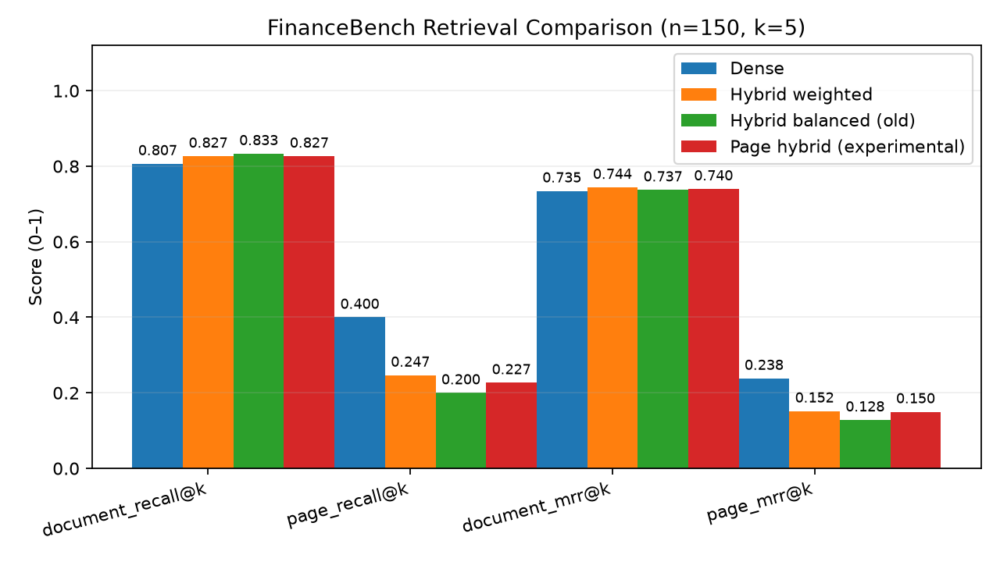

# Financial RAG: Evidence-Grounded Question Answering

An end-to-end **Retrieval-Augmented Generation (RAG)** project for answering questions about financial filings. Built with **Python, PyMuPDF, Sentence Transformers, FAISS, BM25, FastAPI, and Google Gemini**, it retrieves relevant filing excerpts, tracks their source pages, and generates answers with numbered citations.

The project emphasizes **evidence retrieval, reproducible benchmarking, and transparent failure analysis**. Four retrieval approaches were evaluated on the **150-question FinanceBench benchmark**, with dense retrieval delivering the strongest evidence-page results.

> **Project status:** Portfolio-ready AI/ML project. The retrieval pipeline has been evaluated on 150 FinanceBench questions, with dense retrieval achieving 80.67% Document Recall@5 and 40.00% Evidence Page Recall@5. Gemini API integration supports evidence-grounded answer generation with source citations, although responses may occasionally be unavailable due to insufficient retrieved evidence, citation validation, or API-related issues. End-to-end answer accuracy remains to be independently evaluated.

## Highlights

- **43,408 indexed chunks** extracted from public financial filings, with document and PDF-page metadata.
- **Four retrieval strategies:** dense, balanced hybrid, weighted hybrid, and page-level hybrid.
- **Dense retrieval achieves 80.67% Document Recall@5 and 40.00% Evidence Page Recall@5** on 150 FinanceBench questions.
- Page-aware retrieval and deduplication, with **exact zero-indexed evidence-page matching** during evaluation.
- Optional **Gemini-generated answers** with source citations and citation-ID validation.
- **Offline retrieval evaluation** (no Gemini calls), automated tests, and a FastAPI interface.
- **27 tests passed** in the final local run.

## System architecture

```text
                      Financial filings (PDF)
                               |
                 PyMuPDF text / table extraction
                               |
                      Page-aware chunking
                               |
                   MiniLM text embeddings
                               |
                         FAISS index
                               |
 User question ---> Dense retrieval (default) <--- Optional BM25
                               |                        |
                               |                Hybrid RRF experiments
                               |                        |
                               +------------------------+
                               |
                    Unique-page evidence (Top-k)
                         /                 \
                        /                   \
           Offline evaluation        Gemini answer generation
           FinanceBench labels        Grounded evidence prompt
           Recall@k / MRR             Numbered source citations
                        |                   |
                  CSV / JSON / chart    FastAPI /ask response
```

**Benchmark answers and evidence labels are used only for evaluation**, not as retrieval inputs or generation context.

## FinanceBench benchmark results

The final retrieval evaluation was completed on **150 FinanceBench questions**, using **k = 5** and exact matching against zero-indexed PDF evidence pages.

| Retrieval strategy | Document Recall@5 | Evidence Page Recall@5 | Document MRR@5 | Page MRR@5 |
|---|---:|---:|---:|---:|
| **Dense (default)** | 80.67% | **40.00%** | 0.7346 | **0.2383** |
| Weighted Hybrid | 82.67% | 24.67% | **0.7440** | 0.1518 |
| Balanced Hybrid | **83.33%** | 20.00% | 0.7373 | 0.1281 |
| Page Hybrid (experimental) | 82.67% | 22.67% | 0.7399 | 0.1498 |



### Interpretation

- **Dense is the default:** it found a gold evidence page in the top five retrieved pages for **60/150 questions**, outperforming every hybrid variant on page-level retrieval.
- **Hybrid methods locate the correct document slightly more often** (up to **83.33% Document Recall@5**) but frequently rank the wrong pages within that document.
- **Weighted Hybrid improves over Balanced Hybrid** in page recall (**20.00% → 24.67%**) but remains below Dense (**40.00%**).
- **Page Hybrid was evaluated as an experiment**, not adopted as an improvement: its Evidence Page Recall@5 was **22.67%**.

These findings distinguish **document discovery** from **precise evidence localization**—an important challenge when answering questions about numerical financial statements and tables.

**Metric interpretation:** Recall@5 here is a *per-question hit rate*: a question is counted as a hit if **at least one** gold document/page occurs in its top-five unique retrieved results. It is not the fraction of all annotated evidence pages recovered. MRR@5 captures how highly the first matching item was ranked.

**Evaluation integrity:** These are verified development-benchmark results, **not a previously untouched held-out test score**. FinanceBench examples were inspected during iterative retrieval development. The evaluation itself does not feed reference answers or evidence labels into retrieval or Gemini. See [`docs/EVALUATION.md`](docs/EVALUATION.md) for methodology and limitations.

### Final local validation

| Check | Result |
|---|---|
| Automated tests (`python -m pytest -q`) | **27 passed** |
| Dataset available to evaluation | **150 questions** |
| Indexed chunk metadata | **43,408 chunks** |
| Artifact preflight | **PASS** (metadata checks) |
| Four-mode retrieval evaluation | **Completed: 150 questions per mode** |
| Gemini answer-quality evaluation | **Not run / not verified** |

The artifact preflight validates metadata; it is **not** equivalent to a full FAISS index-load or live Gemini API check. The completed retrieval evaluation provides separate evidence that the indexed retrieval path ran in the local environment.

## Retrieval strategies

| Mode | How it works | Role |
|---|---|---|
| `dense` | MiniLM embeddings and FAISS similarity search; page deduplication | **Default** |
| `hybrid` | Weighted reciprocal rank fusion of Dense and BM25 (Dense weight: 3.0) | Comparison |
| `hybrid_balanced` | Equal-weight Dense + BM25 reciprocal rank fusion | Original baseline |
| `page_hybrid` | Experimental page-level fusion (Dense weight: 3.0) | Ablation |

The hybrid methods are retained for reproducible comparisons, **not advertised as improvements over dense retrieval**.

## Quick start

### Prerequisites

- **Python 3.11+** (the final local test run used Python 3.11).
- Internet access for installation and first-time embedding-model downloads; a clean rebuild also downloads financial PDFs.
- A **Gemini API key** only if you intend to generate answers (not required for retrieval evaluation).

### 1. Create the environment (Windows PowerShell)

Run these commands from the **project root**, where `requirements.txt` is located:

```powershell
py -3.11 -m venv .venv
.\.venv\Scripts\Activate.ps1
python -m pip install --upgrade pip
python -m pip install -r requirements.txt
Copy-Item .env.example .env
```

Set `GEMINI_API_KEY` inside `.env` before using the answer-generation endpoint. **Never commit `.env` or your API key.**

### 2. Prepare or verify the index

If using the **archive with the bundled FAISS index**, check its metadata first:

```powershell
python -m scripts.check_setup
```

If using the **source-only GitHub version**, or if `artifacts/manifest.json` is missing, build the index from scratch:

```powershell
python -u prepare.py
```

Wait for the `[prepare] FINISHED` message before running retrieval or evaluation. Preparation includes obtaining available source PDFs, text/table extraction, chunking, embedding, and indexing; it can take time and some external PDF links may no longer work.

**Note:** The source-only repository does not bundle the large FAISS index or PDF corpus. The optional index archive contains the index and metadata, **not** the downloaded embedding-model weights or source PDFs.

### 3. Verify and evaluate

```powershell
python -m pytest -q
python -m scripts.check_setup
python evaluate.py
```

`evaluate.py` runs **all 150 questions across four retrieval modes**, generates retrieval metrics, and **does not call Gemini** by default.

### 4. Try a retrieval-only question

```powershell
python -m scripts.demo_retrieve "What was the capital expenditure of 3M in 2018?"
```

### 5. Start the FastAPI service

```powershell
uvicorn api:app --reload
```

Open **http://127.0.0.1:8000/docs** for the interactive API documentation.

Example request (PowerShell):

```powershell
Invoke-RestMethod -Method Post -Uri http://127.0.0.1:8000/ask `
  -ContentType 'application/json' `
  -Body '{"question":"What was 3M capital expenditure in 2018?","mode":"dense","k":5}'
```

`GET /health` exposes readiness information; `POST /ask` retrieves evidence and requests a Gemini answer. Answers include citation identifiers and PDF source metadata when available. Invalid citation identifiers are rejected/abstained from, but **a valid citation identifier does not prove that a numerical claim is correct or supported**.

## Evaluation commands and outputs

```powershell
python evaluate.py                                            # full retrieval benchmark; no LLM quota
python evaluate.py --limit 10                                 # small smoke test, not a full benchmark
python evaluate.py --answers --limit 10 --answer-mode dense    # optional Gemini answer evaluation
```

The `--answers` option makes real Gemini API requests and may consume rate limits or paid quota. Its token-overlap/F1 measure is **not a substitute for independently checking financial numerical accuracy or citation support**.

Generated retrieval outputs:

```text
artifacts/
├── evaluation.csv       # per-question retrieval results
├── metrics.json         # aggregate metrics and run configuration
└── comparison.png       # four-mode benchmark chart
```

For a lightweight GitHub portfolio repository, the final benchmark artifacts are retained under `reports/` while large and generated index files remain excluded from version control.

## Repository layout

```text
financial_rag/
├── rag.py                    # PDF processing, retrieval, fusion, Gemini grounding
├── prepare.py                # Corpus preparation and indexing
├── evaluate.py               # FinanceBench retrieval / optional answer evaluation
├── api.py                    # FastAPI endpoints
├── requirements.txt
├── .env.example
├── scripts/
│   ├── check_setup.py        # Artifact metadata checks
│   └── demo_retrieve.py      # Retrieval-only demonstration
├── tests/                    # Automated and regression tests
├── docs/
│   ├── ARCHITECTURE.md
│   └── EVALUATION.md
├── reports/                  # Saved benchmark results and chart
├── data/                     # Local benchmark metadata and downloaded PDFs
└── artifacts/                # Local FAISS index and evaluation outputs
```

`data/` and `artifacts/` may be populated by setup/preparation and are not necessarily present in the source-only archive.

## Known limitations and future work

1. **Evidence localization remains the main bottleneck.** Even the best tested approach retrieved a matching evidence page for only 40% of questions at k=5.
2. **Financial tables remain challenging.** Extracted layouts, headers, row/column associations, units, and fiscal-year context may be imperfect; calculations can require information on multiple pages.
3. **Hybrid fusion did not improve page recall.** More relevant candidates are not useful if fusion pushes correct evidence pages below the top five.
4. **Gemini answer quality remains unverified.** Citation-ID validation catches invalid references, not unsupported claims or incorrect arithmetic.
5. **Benchmark tuning limits generalization claims.** Further model or reranker comparisons should use a clearly separated development split and untouched holdout or additional evaluation dataset.

**Potential next steps:** measure Dense Top-50 candidate page recall; evaluate a lightweight cross-encoder reranker with a held-out protocol; improve table-preserving extraction; and conduct a manual, evidence-grounded answer-quality review including numerical correctness, abstention, and citation faithfulness. These are **proposed future experiments, not implemented or verified improvements**.

## References

- [FinanceBench — Patronus AI](https://github.com/patronus-ai/financebench)
- [Google Gemini API documentation](https://ai.google.dev/gemini-api/docs)
- [Gemini API model availability](https://ai.google.dev/gemini-api/docs/models)
- [FAISS](https://github.com/facebookresearch/faiss)
- [Sentence Transformers](https://www.sbert.net/)

---

**Disclaimer:** For research, learning, and portfolio demonstration. Do not rely on automatically generated outputs for financial decisions without independent verification.
